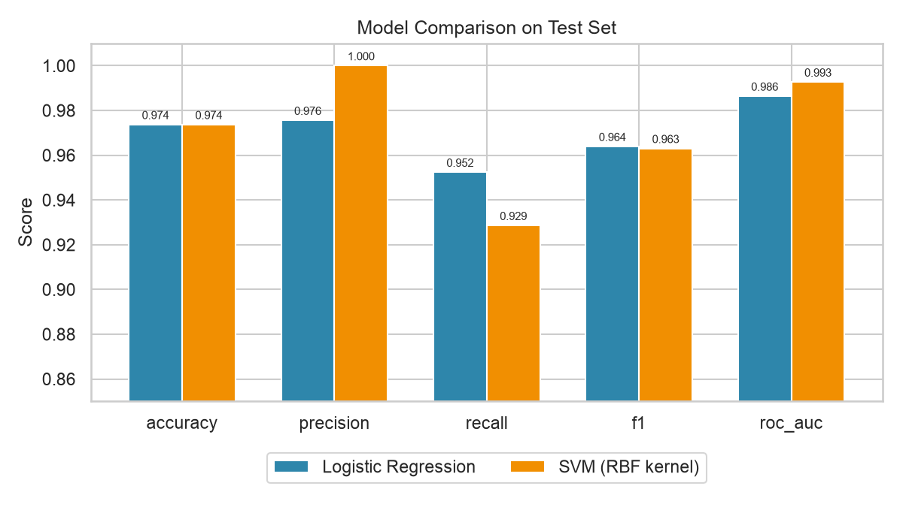
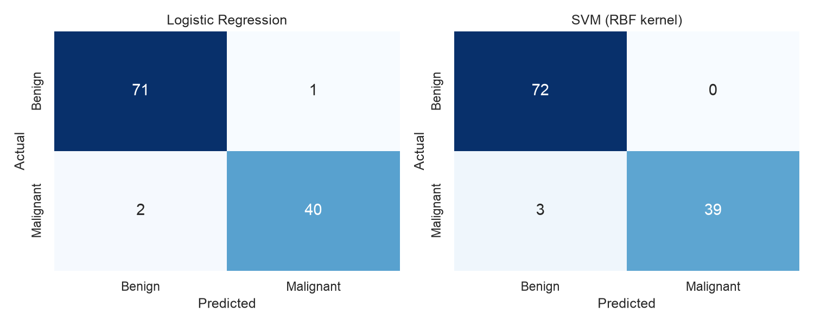

# Breast Cancer Classification using Logistic Regression and SVM

Machine Learning Mini Project (Practical 11), Topic #28

## Problem Statement
Predict whether a breast tumour is **malignant (cancer)** or **benign (not cancer)** from 30 measurements of cell nuclei taken from a fine needle aspirate (FNA) biopsy image. This is a binary classification problem.

## Dataset
- **Breast Cancer Wisconsin (Diagnostic)**, UCI Machine Learning Repository
- Link: https://archive.ics.uci.edu/dataset/17/breast+cancer+wisconsin+diagnostic
- Kaggle mirror: https://www.kaggle.com/datasets/uciml/breast-cancer-wisconsin-data
- 569 patients, 30 numeric features, 357 benign / 212 malignant, no missing values
- Loaded in code with `sklearn.datasets.load_breast_cancer()`, so no download is needed

## Method
1. **Preprocessing:** checked missing values and duplicates, stratified 80/20 train-test split, StandardScaler inside a Pipeline (no data leakage)
2. **Models:** Logistic Regression and Support Vector Machine (RBF kernel)
3. **Tuning:** GridSearchCV with 5-fold cross validation
4. **Evaluation:** accuracy, precision, recall, F1, ROC-AUC, confusion matrix

## Results (test set, 114 patients)
| Metric | Logistic Regression | SVM (RBF) |
|---|---|---|
| Accuracy | 97.37% | 97.37% |
| Precision | 97.56% | 100.00% |
| Recall | 95.24% | 92.86% |
| F1 score | 96.39% | 96.30% |
| ROC-AUC | 0.986 | 0.993 |

**Conclusion:** both models are highly accurate. Logistic Regression is recommended because it has higher recall, so it misses fewer cancers. SVM gives no false alarms (100% precision).




## Repository contents
| File | What it is |
|---|---|
| `breast_cancer_classification.py` | Source code (preprocessing, training, testing, evaluation, charts) |
| `app.py` | Streamlit web app: try predictions and see results in the browser |
| `requirements.txt` | Python libraries needed |
| `1_...png` to `7_...png` | 7 result charts |
| `results.json` | All metrics |
| `Project_Report_Breast_Cancer_Classification.pdf` / `.docx` | Project report |
| `Presentation_Breast_Cancer_Classification.pdf` / `.pptx` | Presentation slides |

## How to run
```
pip install -r requirements.txt
python breast_cancer_classification.py
```
Each chart opens in a window (close it to see the next) and is saved in the `charts/` folder.

## Web app
Run locally with `streamlit run app.py`, or open the live version: _add your Streamlit link here_

## Group members
1. Raj Darji
2. Tirth Patel
